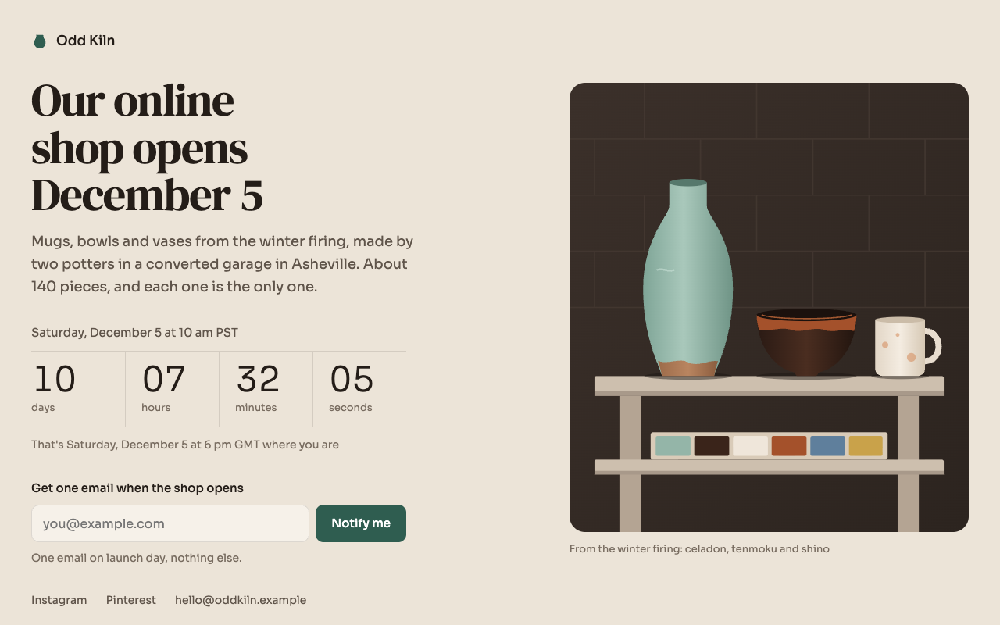

# Odd Kiln: coming soon page template

A coming soon page with a countdown that shows the launch time in the visitor's own time zone, an email sign-up, social links and a teaser image. Plain HTML, CSS and a little JavaScript, no build step. The demo is a fictional pottery studio opening its online shop.



[](https://console.cloudzyro.com/new?repo=https://github.com/Cloudzyro/template-coming-soon)

## What's included

- Countdown to a date and time you set, with the launch time written out in your time zone and the visitor's
- After launch, the page switches by itself: the countdown and sign-up go, and a "Visit the shop" button appears
- Email sign-up that posts to any form service, or opens the visitor's email app when none is set
- Social links and a hand-built SVG teaser (no stock photos)
- Light and dark, following the device setting
- SEO: title, description, Open Graph and Twitter tags, `sitemap.xml`, `robots.txt`, SVG favicon
- Self-hosted fonts (DM Serif Display and Sora), no third-party scripts, no tracking
- One screen on desktop, stacks cleanly down to 360px, visible focus styles, reduced motion respected

## Run it locally

```bash
pnpm install
pnpm dev        # http://localhost:3000
```

There's nothing to build. Add `?preview=open` to the address to see the page as it will look after launch.

## Make it yours

- **Launch date, shop link and form address:** `config.js`. Write the date with its time zone offset (for example `2026-12-05T10:00:00-08:00`) and set `timeZone` to the zone you want it described in.
- **Email sign-up:** set `formEndpoint` in `config.js` to your form service's address (Formspree, Basin, Buttondown, a Supabase function or similar). It receives a normal form POST with an `email` field. Left empty, the form opens the visitor's email app with a note addressed to `email`.
- **Words:** `index.html`. Text shown before launch is marked `data-before`; text shown after is marked `data-after`.
- **Colors and fonts:** the variables at the top of `styles.css` (light first, then dark). Fonts are in `fonts/` (SIL Open Font License, see the `OFL-*.txt` files).
- **Teaser:** replace `images/kiln-shelf.svg` with your own picture and update its `alt` text.
- **Your address on the web:** replace `https://oddkiln.example/` in `index.html`, `robots.txt` and `sitemap.xml`, and `images/og.png` (1200x630) for social cards.

## Deploy

Click the **Deploy to Cloudzyro** button above, or push your own copy to GitHub and connect it in the Cloudzyro console. No build command is needed: the folder is served as static files.

## Stack

- HTML, CSS and plain JavaScript (`config.js`, `script.js`)
- [serve](https://github.com/vercel/serve) for local preview only

## License

MIT, see [LICENSE](./LICENSE).
